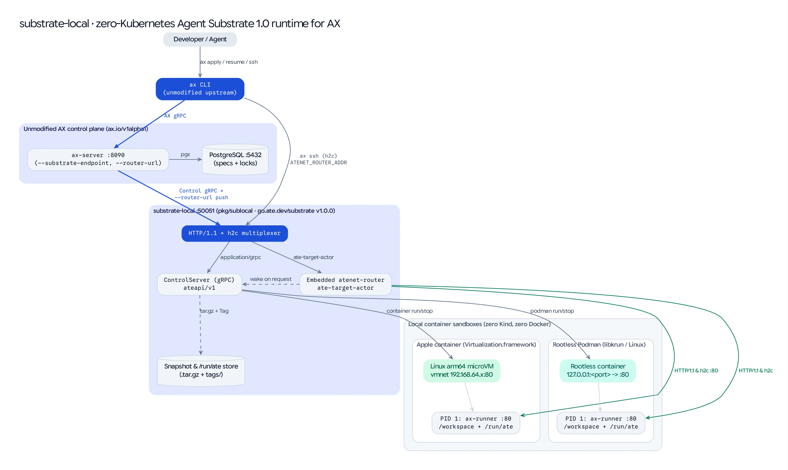

# substrate-local

A standalone, zero-Kubernetes local runtime implementing the [Agent Substrate](https://github.com/agent-substrate/substrate) `v1.0.0` Control API (`ateapi/v1.ControlServer`) and `atenet-router` (`ate-target-actor` HTTP/1.1 + HTTP/2 `h2c`) over macOS Apple `container` (`Virtualization.framework`) or rootless Podman.

[](https://github.com/ghchinoy/substrate-local/actions/workflows/ci.yml)
[](go.mod)
[](LICENSE)

Point unmodified upstream [AX](https://github.com/google/ax) (`ax-server` + `ax` CLI) directly at `substrate-local` via standard flags (`--substrate-endpoint`, `--substrate-plaintext`, `--router-url`) — zero `google/ax` fork, zero Kind, zero Docker, and zero rootful VM required.

## Contents

- [Install](#install)
- [Usage](#usage)
- [Architecture](#architecture)
- [Local Development](#local-development)
- [Testing & AX Compatibility](#testing--ax-compatibility)
- [Releasing](#releasing)
- [Contributing](#contributing)
- [License](#license)

## Install

### Prerequisites

- **Go `1.27+`** (set `export GOTOOLCHAIN=auto` if your local Go is older)
- **Container runtime** (either or both):
  - **macOS Apple `container`:** `/usr/local/bin/container` (`container system start`)
  - **Podman (macOS or Linux):** `podman machine start` (default rootless mode works out of the box)

### Install with Go

```bash
go install github.com/ghchinoy/substrate-local/cmd/substrate-local@latest
substrate-local --version
```

Prebuilt `darwin` and `linux` (`arm64` / `amd64`) archives with `checksums.txt` are also published on [GitHub Releases](https://github.com/ghchinoy/substrate-local/releases).

## Usage

### 1. Run `substrate-local` with an unmodified upstream `ax-server`

Start the local Substrate Control API and embedded `atenet-router` on `:50051`:

```bash
substrate-local \
  --runtime apple \
  --addr 127.0.0.1:50051 \
  --snapshot-dir /tmp/substrate-snapshots
```

Connect an unmodified upstream `ax-server` (`v0.4.0-rc.2+`):

```bash
ax-server \
  --addr 127.0.0.1:8090 \
  --store "postgres://ax:ax@127.0.0.1:5432/ax?sslmode=disable" \
  --substrate-endpoint 127.0.0.1:50051 \
  --substrate-plaintext \
  --router-url http://127.0.0.1:50051
```

### 2. One-command local AX stack (no `google/ax` clone required)

`make up` starts PostgreSQL, `substrate-local`, and unmodified upstream `ax-server` (automatically downloading `github.com/google/ax@v0.4.0-rc.2` via Go modules when no local clone is present):

```bash
git clone https://github.com/ghchinoy/substrate-local.git
cd substrate-local
make up                                 # starts PostgreSQL (:5432), substrate-local (:50051), ax-server (:8090)
source .substrate-local/env             # exports AX_SERVER, ATENET_ROUTER_ADDR, and PATH

ax apply -f examples/task-local.yaml
ax resume task local-task
ax describe task local-task             # State: Running, Ready: True
ax ssh local-task -- uname -sm          # Linux aarch64
ax suspend task local-task              # State: Suspended (0 RAM, /workspace snapshotted)
ax resume task local-task
ax delete task local-task

make down
```

### 3. Dual-cluster cross-runtime mobility (Apple `container` ↔ rootless Podman)

Run Cluster A on Apple `container` (`:8090` / `:50051`) and Cluster B on rootless Podman (`:8091` / `:50052`) sharing `.substrate-local/snapshots/`:

```bash
make multi-up
source .substrate-local/env

ATENET_ROUTER_ADDR=$ATENET_ROUTER_ADDR_A ax --server $AX_SERVER_A apply -f examples/task-local.yaml
ATENET_ROUTER_ADDR=$ATENET_ROUTER_ADDR_A ax --server $AX_SERVER_A resume task local-task
ATENET_ROUTER_ADDR=$ATENET_ROUTER_ADDR_A ax --server $AX_SERVER_A ssh local-task -- sh -c 'echo "from apple" > /workspace/proof.txt'

./scripts/ax-stack.sh migrate local-task

ATENET_ROUTER_ADDR=$ATENET_ROUTER_ADDR_B ax --server $AX_SERVER_B ssh local-task -- cat /workspace/proof.txt
make multi-down
```

### 4. Embed `pkg/sublocal` in Go

`pkg/sublocal` has zero dependency on `github.com/google/ax` (only `go.ate.dev/substrate v1.0.0`, gRPC, Protobuf, and YAML):

```go
cfg := sublocal.DefaultConfig()
cfg.Runtime = sublocal.RuntimeApple // or sublocal.RuntimePodman
cfg.SnapshotDir = "/tmp/substrate-snapshots"

srv, err := sublocal.NewServer(cfg)
if err != nil {
	log.Fatal(err)
}
grpcServer := grpc.NewServer()
srv.Register(grpcServer)
log.Fatal(srv.NewHTTPServer("127.0.0.1:50051", grpcServer).ListenAndServe())
```

## Architecture

Running full Agent Substrate locally via Kind (`ax local start`) provides full production parity (including `atenet-egress` TLS Secret injection), at the cost of a 6–8 GiB rootful Linux VM, kernel >= 6.8, and ~3–5 minutes on a fresh cluster.

`substrate-local` is a complementary lightweight tier (~3-second startup, 0-RAM suspend/resume, `Tag` snapshot fan-out, embedded HTTP/1.1 + `h2c` `atenet-router`, and `--entrypoint` parity) built directly against `go.ate.dev/substrate@v1.0.0`:

<picture>
  <source media="(prefers-color-scheme: dark)" srcset="docs/diagrams/01-substrate-local-architecture-dark.webp">
  <source media="(prefers-color-scheme: light)" srcset="docs/diagrams/01-substrate-local-architecture-light.webp">
  
</picture>

See [`docs/architecture.md`](docs/architecture.md) for actor lifecycle and dual-cluster diagrams, full Control API coverage, and configuration reference.

### Guides & Further Reading

- **[Apple `container` Quickstart (macOS)](docs/quickstart-apple-container.md)** — Zero-Docker walkthrough from `container system start` to `Workspace` fan-out and 0-RAM suspend/resume.
- **[Rootless Podman Quickstart (macOS & Linux)](docs/quickstart-podman.md)** — Standalone rootless Podman setup (`AX_LOCAL_RUNTIME=podman make up`) and dual-runtime migration.
- **[Choosing a Runtime: `substrate-local` vs. Kind vs. GKE](docs/choosing-a-runtime.md)** — Compatibility boundary and when to graduate to Kind (`ax local`) or Google Cloud GKE.
- **[Integrating External Go Apps (`docs/go-app-integration.md`)](docs/go-app-integration.md)** — Ephemeral one-shot audit job pattern (`verdict.json` / `patch.diff`), stack discovery (`AX_SERVER` / `ATENET_ROUTER_ADDR` / `pkg/sublocal`), and offline/untrusted-code guidance.
- **[AX & Agent Substrate Concepts & Swarm Examples (`ghchinoy/ax-experiments`)](https://github.com/ghchinoy/ax-experiments)** — Visual architecture guides (`concepts/`) and multi-agent swarm, Genkit, and HITL recipes powered by `substrate-local`.

## Local Development

```bash
git clone https://github.com/ghchinoy/substrate-local.git
cd substrate-local
export GOTOOLCHAIN=auto

make build                              # builds ./bin/substrate-local with version/commit ldflags
make test                               # runs go test -race -v ./... (unit + live Apple container test)
make vet                                # runs go vet ./...
```

### Key environment variables and ports

| Variable | Default | Purpose |
|---|---|---|
| `AX_VERSION` | `v0.4.0-rc.2` *(fallback)* | Upstream `google/ax` tag/branch/commit built from the Go module cache when set or when `AX_REPO` is absent |
| `AX_REPO` | `~/projects/ax` | Local `google/ax` checkout used by `scripts/ax-stack.sh` when `AX_VERSION` is unset |
| `SUBSTRATE_LOCAL_RUNTIME` | `apple` | Container runtime (`apple` or `podman`) |
| `AX_LOCAL_POSTGRES_PORT` | `5432` | Local PostgreSQL container port |
| `AX_LOCAL_SUBSTRATE_PORT` | `50051` | Cluster A `substrate-local` gRPC + router port (`50052` for Cluster B) |
| `AX_LOCAL_SERVER_PORT` | `8090` | Cluster A `ax-server` gRPC port (`8091` for Cluster B) |

Re-render the dual-theme Graphviz diagrams after editing `docs/diagrams/*.dot` (requires `gvpr`, `dot`, and `../graphviz-style`):

```bash
make diagrams
```

## Testing & AX Compatibility

Run the contract regression suite against any unmodified upstream `google/ax` checkout:

```bash
make test                               # Go unit + live Apple container tests (~5s)
make test-compat                        # fresh upstream hack/tour.sh + PID-1/plain-image + h2c ax ssh stress (~45s)
TEST_PODMAN=1 make test-compat          # also tests Apple container <-> rootless Podman migrate & ax promote
```

Verified against **`google/ax` `v0.4.0-rc.2`+ (`8d879b5`)**:
- **Passes:** `Task` lifecycle (`Suspended`/`Running`), `Workspace` setup (`git` + `files` + `commands`) & `Tag` snapshot fan-out isolation, `--router-url` inbound task push, launcher contract (`AX_*_FILE` + `AX_METADATA_URL`), `ax ssh` (`h2c`), `suspend`/`resume` `/workspace` persistence, multi-tenant atespaces, `Model` CRUD, `ax promote`, and cross-runtime migration.
- **Known limitations:**
  1. **Volumes-fidelity snapshots (`SNAPSHOT_FIDELITY_VOLUMES`):** Archives `/workspace` on suspend/resume; in-memory process state is not checkpointed (no `runsc --checkpoint`).
  2. **No `atenet-egress` L7/TLS proxy or Kubernetes Secret injection:** `ActorEgressPolicy` RPCs are stored so `Gateway` validation succeeds, but outbound internet access is not blocked on the host bridge and Kubernetes Secret header injection requires a full Agent Substrate cluster (`ax local start`).

## Releasing

Releases are automated via [`.github/workflows/release.yml`](.github/workflows/release.yml). To cut a release:

1. Move entries from `## [Unreleased]` to `## [X.Y.Z] - YYYY-MM-DD` in [`CHANGELOG.md`](CHANGELOG.md) and commit on `main`.
2. Tag and push:
   ```bash
   git tag -a vX.Y.Z -m "vX.Y.Z"
   git push origin vX.Y.Z
   ```
3. GitHub Actions verifies (`go vet`, `go test -race`, `bash -n`), builds `darwin`/`linux` (`arm64`/`amd64`) archives with `checksums.txt`, and publishes the GitHub Release. You can also dry-run the archive build without publishing via `workflow_dispatch`.

## Contributing

Pull requests and issues are welcome. For larger changes or new runtime backends, please open an issue first to discuss the approach.

Before opening a PR, please run:

```bash
make fmt && make vet && make test
```

Keep `pkg/sublocal` and `cmd/substrate-local` free of `github.com/google/ax` Go module imports so this daemon remains strictly decoupled at the `go.ate.dev/substrate` API boundary.

## License

Licensed under the [Apache License, Version 2.0](LICENSE).
