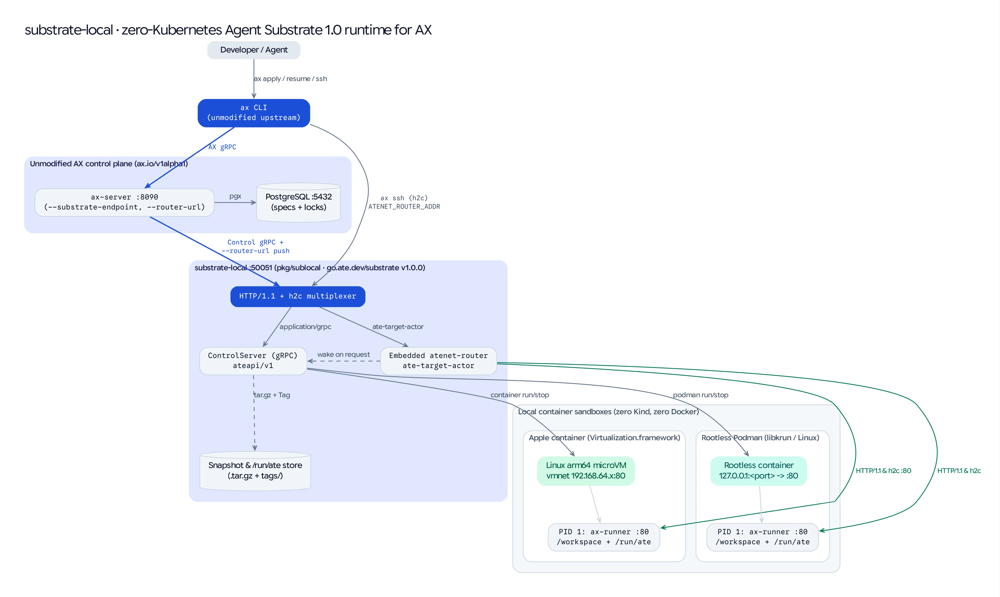
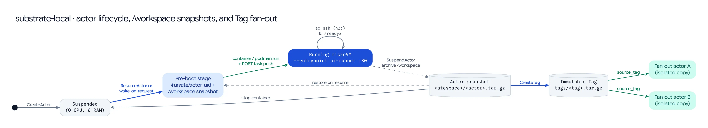
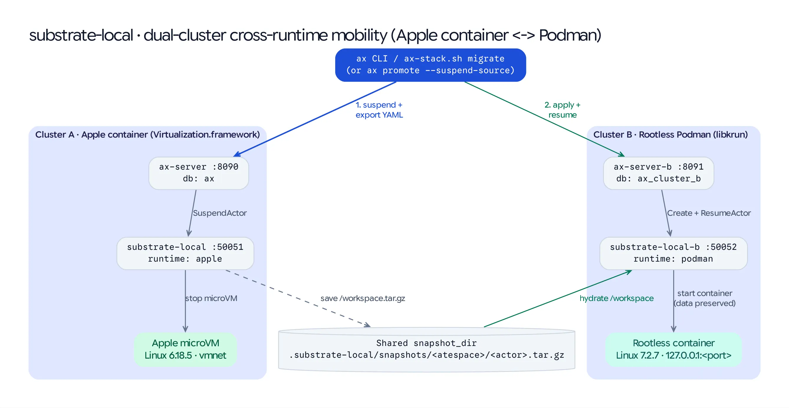

# Architecture & Operations (`substrate-local`)

`substrate-local` implements the **Agent Substrate `v1.0.0` Control gRPC API** (`go.ate.dev/substrate/api/ateapi/v1.ControlServer`) together with an embedded **`atenet-router`** (`ate-target-actor` HTTP/1.1 + HTTP/2 `h2c` reverse proxy), backed by macOS native **Apple `container`** (`/usr/local/bin/container` on `Virtualization.framework`) or **Podman** (`podman`, including default rootless `podman machine`).

## Architecture Overview

<picture>
  <source media="(prefers-color-scheme: dark)" srcset="diagrams/01-substrate-local-architecture-dark.webp">
  <source media="(prefers-color-scheme: light)" srcset="diagrams/01-substrate-local-architecture-light.webp">
  
</picture>

## Actor Lifecycle, Snapshots & Tag Fan-Out

<picture>
  <source media="(prefers-color-scheme: dark)" srcset="diagrams/02-lifecycle-and-snapshots-dark.webp">
  <source media="(prefers-color-scheme: light)" srcset="diagrams/02-lifecycle-and-snapshots-light.webp">
  
</picture>

## Dual-Cluster Cross-Runtime Mobility

<picture>
  <source media="(prefers-color-scheme: dark)" srcset="diagrams/03-dual-cluster-mobility-dark.webp">
  <source media="(prefers-color-scheme: light)" srcset="diagrams/03-dual-cluster-mobility-light.webp">
  
</picture>

*(Re-render all diagrams via `make diagrams` using `../graphviz-style/theme/lustrous.gvpr`.)*

## Production Agent Substrate vs. `substrate-local`

| Agent Substrate Concept | Production (Kubernetes + gVisor) | `substrate-local` (`runtime: apple`) | `substrate-local` (`runtime: podman`) |
|---|---|---|---|
| **Control Plane** | `ate-api-server` | `substrate-local` gRPC daemon (`pkg/sublocal`) | `substrate-local` gRPC daemon (`pkg/sublocal`) |
| **Container Runtime** | `ateworker-gvisor` Pods (`runsc`) | macOS Apple `container` (`Virtualization.framework`) | Podman (rootless `libkrun` or Linux) |
| **Container Entrypoint** | `Container.command` overrides entrypoint | `--entrypoint <cmd[0]> <image> <cmd[1:]...>` | `--entrypoint <cmd[0]> <image> <cmd[1:]...>` |
| **Actor Networking** | Pod IP routed via `atenet-router` | Direct `vmnet` IP (`192.168.64.x:80`) | Published localhost port (`127.0.0.1:<hostPort>`) |
| **Actor Identity** | `/run/ate/actor-uid` volume projection | Bind-mounted `<snapshot_dir>/actor-meta/...:/run/ate` | Bind-mounted `<snapshot_dir>/actor-meta/...:/run/ate` |
| **Suspend (`SuspendActor`)** | `runsc` checkpoint / volume snapshot to GCS | Archives `/workspace` to `snapshot_dir` + `container stop` | Archives `/workspace` to `snapshot_dir` + `podman stop` |
| **Resume (`ResumeActor`)** | Hydrates snapshot into worker pod | Starts/creates Apple container + restores `/workspace` | Starts/creates Podman container + restores `/workspace` |
| **Inbound Router (`atenet-router`)** | Envoy + `atenet-router` (`ate-target-actor`) | Embedded HTTP/1.1 + `h2c` proxy on `:50051` | Embedded HTTP/1.1 + `h2c` proxy on `:50052` |

## Control API Surface Implemented (`pkg/sublocal`)

- **Atespaces:** `CreateAtespace`, `GetAtespace`, `ListAtespaces`, `DeleteAtespace`
- **ActorTemplates:** `CreateActorTemplate`, `GetActorTemplate`, `ListActorTemplates`, `DeleteActorTemplate`
- **Actors:** `CreateActor` (including `source_tag` seeding), `GetActor`, `ListActors`, `ResumeActor`, `SuspendActor`, `RevertActor`, `DeleteActor`
- **Snapshot Tags:** `CreateTag`, `GetTag`, `ListTags`, `DeleteTag`
- **Egress Policies:** `CreateActorEgressPolicy`, `GetActorEgressPolicy`, `UpdateActorEgressPolicy`, `DeleteActorEgressPolicy`
- **Workers:** `ListWorkers`

## Embedding `pkg/sublocal` in Go

```go
cfg := sublocal.DefaultConfig()
cfg.Runtime = sublocal.RuntimeApple // or sublocal.RuntimePodman
cfg.SnapshotDir = "/tmp/substrate-snapshots"

srv, err := sublocal.NewServer(cfg)
if err != nil {
    log.Fatal(err)
}
grpcServer := grpc.NewServer()
srv.Register(grpcServer)
httpServer := srv.NewHTTPServer("127.0.0.1:50051", grpcServer)
log.Fatal(httpServer.ListenAndServe())
```

## Configuration & Environment Variables

| Env Var (legacy alias) | Config YAML Key | Default | Description |
|---|---|---|---|
| `SUBSTRATE_LOCAL_RUNTIME` (`ATE_LOCAL_RUNTIME`) | `runtime` | `apple` | `apple` or `podman` |
| `SUBSTRATE_LOCAL_SNAPSHOT_DIR` (`ATE_LOCAL_SNAPSHOT_DIR`) | `snapshot_dir` | *(empty)* | Host directory for `/workspace` snapshots, `tags/`, and `/run/ate` metadata |
| `SUBSTRATE_LOCAL_SETUP_IMAGE` (`ATE_LOCAL_SETUP_IMAGE`) | `setup_image` | `alpine/git` | Fallback image for legacy warm setup |
| `SUBSTRATE_LOCAL_INIT_IMAGE` (`ATE_LOCAL_INIT_IMAGE`) | `init_image` | *(auto)* | Optional custom Apple `container` `vminit` image |
| `AX_VERSION` | *(script)* | `v0.4.0-rc.2` *(fallback)* | Clone-free upstream `google/ax` module tag/branch/commit (e.g. `v0.4.0-rc.2`, `main`) built straight from the Go module cache |
| `AX_REPO` | *(script)* | `~/projects/ax` | Local `google/ax` checkout used when `AX_VERSION` is unset and the directory exists |

## Limitations

1. **Volumes-Fidelity Snapshotting (`SNAPSHOT_FIDELITY_VOLUMES`):** Neither Apple `container` nor Podman on macOS exposes a userspace memory checkpoint/restore primitive (`runsc --checkpoint`). `SuspendActor` snapshots `/workspace` and stops the container, and `ResumeActor` restores `/workspace` into the resumed/migrated container. In-memory process state is not preserved across suspend/resume.
2. **Architecture:** Apple Silicon Macs run `linux/arm64` containers natively in both Apple `container` and `podman`. `scripts/ax-stack.sh` cross-compiles `ax-runner` for `linux/arm64` when building from `AX_REPO` and mounts it into stock task images via the default template.
3. **Outbound Egress Enforcement & Secret Injection (`atenet-egress`):** `substrate-local` stores and returns `ActorEgressPolicy` records on the Control API so `ax-server` and `Gateway` validation succeed, and passes all control-plane, `Workspace` snapshot/fan-out, `--router-url` push, and `ax ssh` steps of `google/ax`'s `./hack/tour.sh`. However, it does not run an L7/TLS `atenet-egress` proxy on the container network bridge: tasks without a `Gateway` are not blocked from outbound internet access on the host network, and `Gateway` / `Model` Kubernetes Secret header injection requires a full Agent Substrate cluster.
